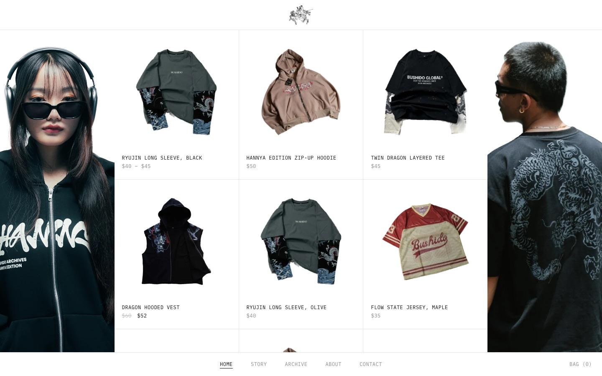
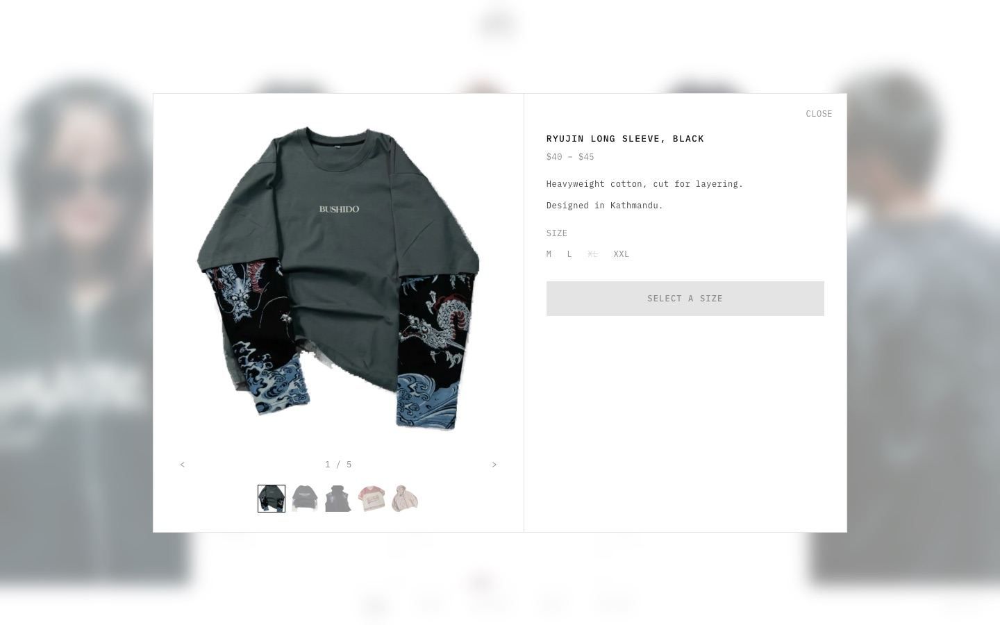
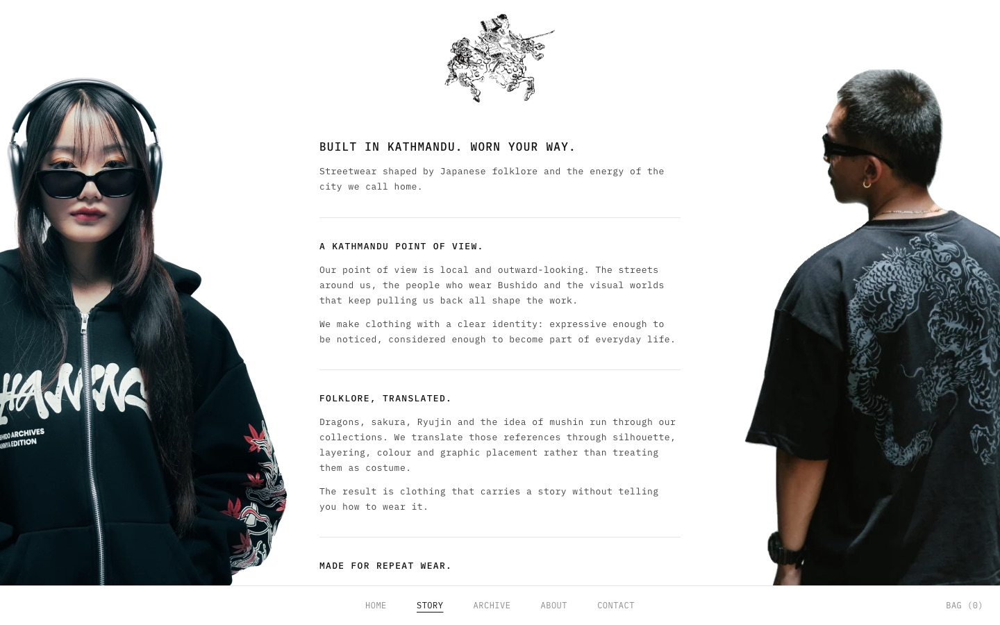
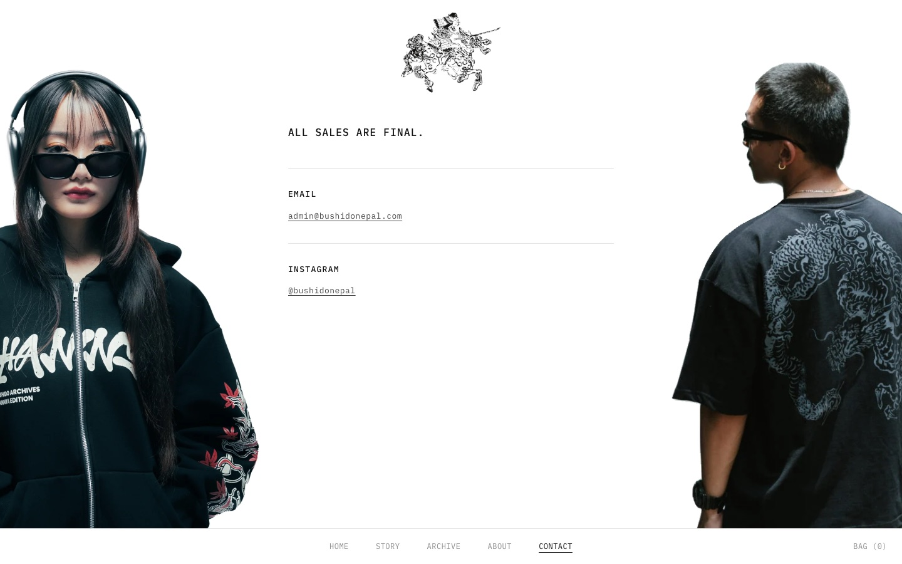
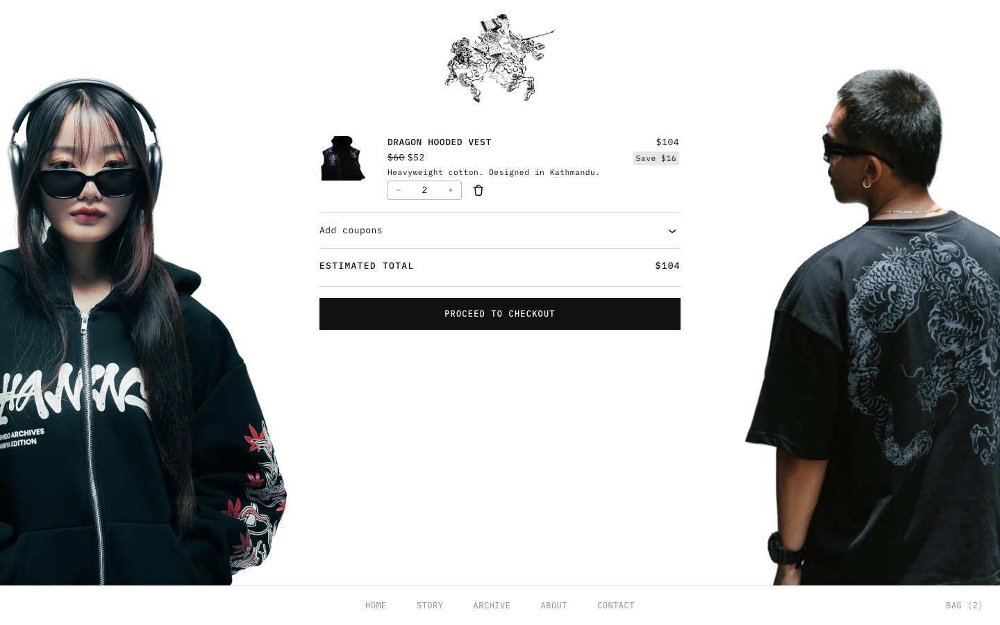
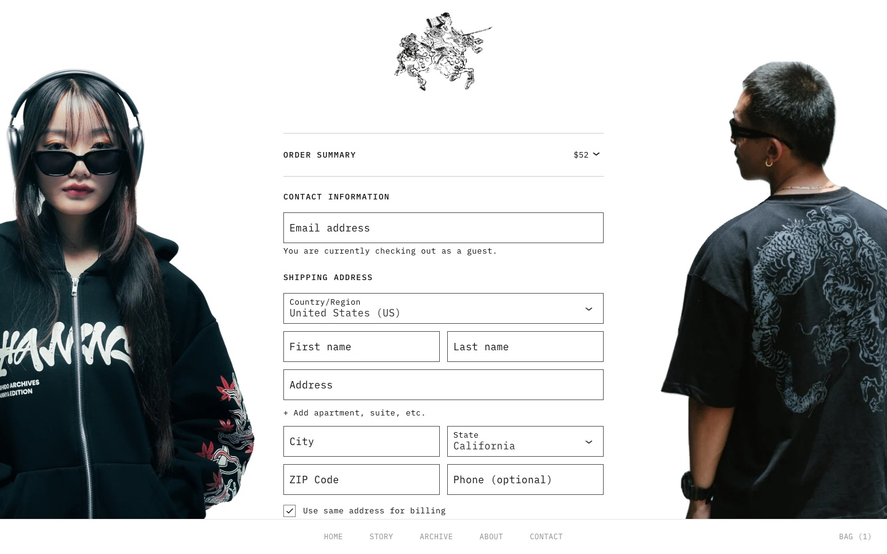
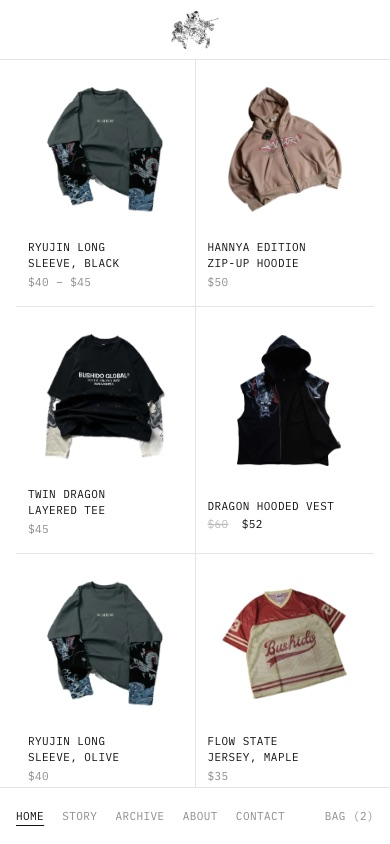
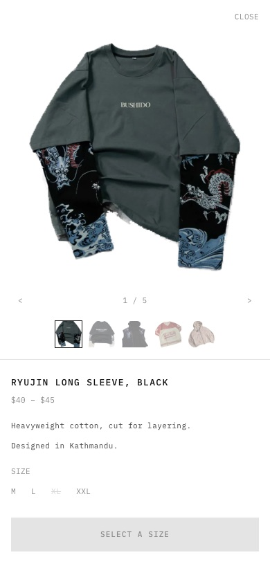

# Bushido US: WordPress storefront theme

A custom WooCommerce theme for the US store of [Bushido](https://www.bushidonepal.com), a streetwear label from Kathmandu. Built from scratch as a classic PHP theme, replacing a page-builder setup with a quiet, monospace storefront: a hairline product grid between two fixed figures, products that open in place over the grid, and a few editorial pages.

**Live preview:** [us.bushidonepal.com](https://us.bushidonepal.com/)



## What's in it

**Home is the shop.** In-stock products sit in a hairline grid where lines run between cells, never around the outside. Two cut-out figures stay fixed in the side panels while the grid scrolls between them. Sold-out pieces move to an Archive page instead.

**Products open in place.** Clicking a product zooms the card into a dialog over a blurred page, with no page load.



- A native `<dialog>` with a FLIP animation from the card's position (Web Animations API). Esc, the backdrop, Close and the browser's Back button all close it.
- The product's URL is pushed to history, so links are shareable. Opening one directly renders Home with that dialog already open.
- Dialog content is server-rendered into an inert `<template>` next to each card. It opens instantly and still works behind page caching.
- Sizes are plain text toggles, and you can pick several at once. Each one becomes a separate WooCommerce variation in the bag. The add-to-cart requests run one after another, because parallel requests race on the cart session and drop items.
- The Bag count updates through WooCommerce cart fragments, so it stays right on cached pages.

**Story, Contact, Cart and Checkout share an editorial layout.** The logo grows on the way in and shrinks on the way out, using cross-document View Transitions. The side figures keep their exact size and position but drop their crop, so the whole figure shows in front of the centre column. Text runs down the middle, one section per heading, and editors can write it in the block editor.

| Story | Contact |
|---|---|
|  |  |

| Cart | Checkout |
|---|---|
|  |  |

**Built for phones too.** The grid drops to two columns and the figures step aside. The product dialog becomes a full-screen sheet.

<p>
  
  
</p>

## How it's built

- **Classic PHP theme**, no page builder and no build step. One stylesheet (`style.css`) and one small vanilla-JS file for the dialog (`assets/js/product-dialog.js`).
- **WooCommerce** through a handful of template overrides (`woocommerce/`), so every product loop, including categories, uses the same card. Every WooCommerce call is guarded, so the theme still renders if the plugin is off.
- **Variable products** are handled generically. Size is the multi-select option, any other attribute (like Colour) is single-select, and sold-out variations are disabled.
- **Empty cart** shows only its message: the theme skips WooCommerce's "New in store" block with `pre_render_block`.
- **Editor-friendly.** The side figures and logo can be swapped in the Customizer. Story and Contact fall back to default copy while their pages are empty.
- **Tested locally** against WordPress Playground with WooCommerce and realistic sample products. A Puppeteer script clicks through the dialog: open and close by every route, gallery, multi-size add to bag, cart lines, deep links, the Shop redirect and phone widths.

## Structure

```
bushido-us/
  style.css                    theme header and all styles
  functions.php                setup, WooCommerce wiring, helpers
  header.php / footer.php      logo bar, side figures, bottom nav, dialog element
  front-page.php               Home (the shop)
  woocommerce.php              product URLs and categories
  page-story.php               Story
  page-contact.php             Contact
  page-archive.php             sold-out Archive
  page.php / index.php         other pages, Cart, fallbacks
  template-parts/              product card, product dialog, home grid, story layout
  woocommerce/                 loop and card overrides
  assets/js/product-dialog.js  zoom, gallery, size picker, add to bag
```

## Install

1. Install and activate **WooCommerce**. Set the currency to USD with 0 decimals.
2. Zip the `bushido-us` folder, then go to **Appearance → Themes → Add New → Upload Theme** and activate it.
3. Create pages with the slugs `story`, `contact` and `archive`. They pick up their layouts automatically, and Story and Contact show default copy until you write your own. `story-content.html` and `contact-content.html` hold that copy as block markup: paste it into the page's Code editor to start editing.
4. Optionally swap the side figures and logo under **Appearance → Customize**. Transparent cut-outs around 1,500 px work best.

`product-images/` has the transparent product cut-outs the grid is designed around.

## Credits

Design and development by [Saurav Dhakal](https://github.com/dhakalsaurav11). Product photography and brand assets © Bushido Nepal.
